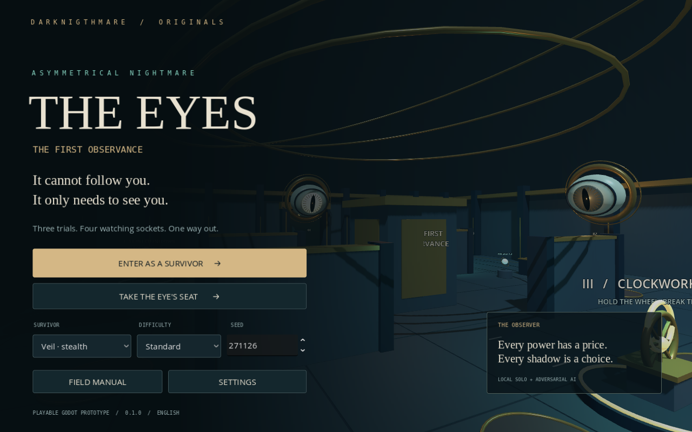
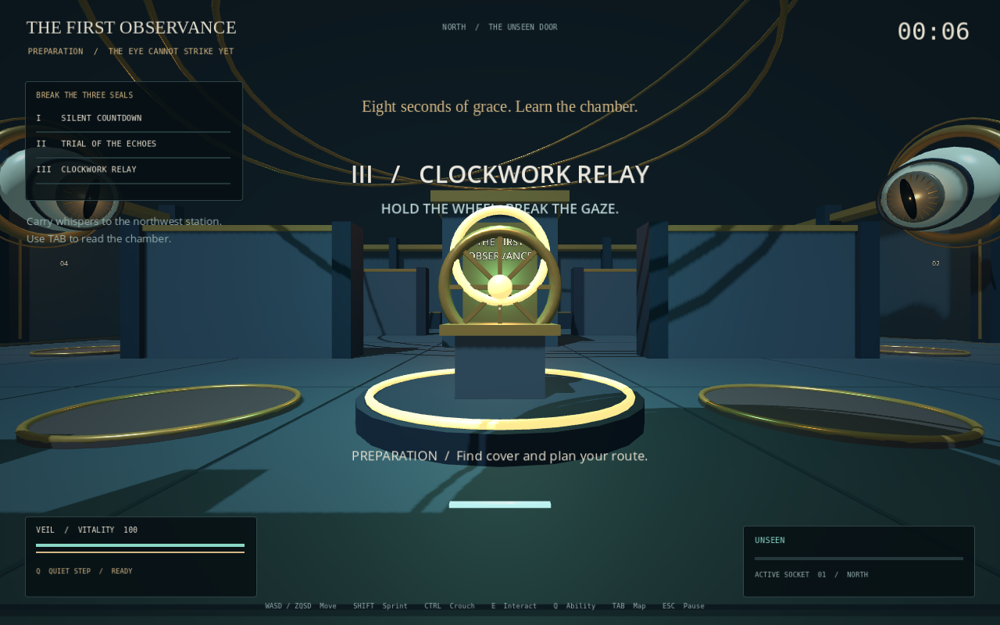

# THE EYES

### The First Observance · playable prototype 0.1.0

**It cannot follow you. It only needs to see you.**

An original asymmetrical nightmare game by **Darknigthmare**. Survivors break
three trial seals and escape a hostile observatory. A gigantic, immobile Eye
changes between authored sockets, watches real sightlines, commands traps and
calls stalking shadows. Its gaze is powerful; architecture, time and influence
limit it.

This repository includes a **playable local 3D Godot game**, an **English game
bible covering all 25 proposed trials**, and a **UE5 Blueprint-only construction
foundation**. The long-term target is 5–7 survivors versus one human or AI Eye.
The prototype offers a human survivor versus AI, or a human Eye versus four
physical AI survivors. Online multiplayer is a later milestone.



## Start here

**[Download the Windows x64 prototype](https://github.com/darknigthmare/THE_EYES/releases/download/v0.1.0/THE_EYES_v0.1.0_Windows_x64.zip)**
· [Release notes and checksums](https://github.com/darknigthmare/THE_EYES/releases/tag/v0.1.0)

Extract the complete ZIP and run `THE_EYES.exe`; Godot is not required.
The package is an unsigned development build. Its export and archive are
verified; execution on native Windows hardware remains to be checked.

| I want to… | Open |
| --- | --- |
| Play | [Quick start](docs/PLAY.md) · [Guide français](docs/DEMARRAGE_FR.md) |
| Read the complete design | [Game bible index](docs/bible/README.md) |
| Explore the 25 challenges | [Trial catalogue](docs/bible/06_TRIAL_CATALOGUE.md) |
| Inspect the source | [Godot project](game/project.godot) · [Scene controller](game/scripts/main.gd) |
| Build the Unreal version | [UE5 foundation](unreal/README.md) · [Blueprint implementation](docs/technical/UE5_BLUEPRINT_IMPLEMENTATION.md) |
| Understand network authority | [Network and save contracts](docs/technical/NETWORK_AND_SAVE_CONTRACTS.md) |
| Produce final assets | [Art, animation and sound production](docs/technical/ASSET_PRODUCTION.md) |
| Review actual verification | [Report](docs/qa/VERIFICATION.md) · [Tests](game/tests/README.md) |
| Compare with the source brief | [Supplied concept](docs/source/ORIGINAL_CONCEPT.txt) |

## Play the Godot source

Tested with **Godot 4.7.2**, standard version; .NET is unnecessary.

1. Clone or download this repository.
2. Import `game/project.godot` in Godot.
3. Press **F5** to run the project.
4. Choose an archetype, difficulty and seed, then select either role.

```bash
godot --editor --path game --import
godot --path game
```

The game needs no API key, account, server, downloaded asset pack or plugin.
All prototype geometry, sounds and fonts are included.

### Controls

Labels use physical QWERTY key positions. On an AZERTY keyboard, movement is
ZQSD and the Q-labelled ability is on **A**. The top-row 1–4 positions select
symbols or sockets without requiring Shift.

| Survivor | Action |
| --- | --- |
| WASD / ZQSD or arrows; mouse | Move; look |
| Shift; Ctrl/C; Space | Sprint; crouch; jump |
| E / hold E; Q | Interact / charge / escape; archetype ability |
| 1–4; R | Echo symbols; replay pattern |
| Tab; Escape | Chamber map; pause/settings |

| The Eye | Action |
| --- | --- |
| Mouse; 1–4 / wheel | Rotate fixed view; change socket |
| Left / right mouse | Trigger visible floor trap / mark visible survivor |
| Q | Summon a shadow on visible, unoccupied ground |
| Tab; Escape | Map; pause/settings |

## A complete local match

**Silent Countdown:** carry three distinct whisper motes to the northwest
station, one at a time. A carried mote rings when you sprint.

**Trial of the Echoes:** watch a four-symbol, seed-dependent sequence and repeat
it using 1–4. The world and Eye remain active while the panel is open.

**Clockwork Relay:** hold E near the south wheel. Four and eight seconds of work
bank progress; twelve complete the seal. Tinker modifies the work rate.

All three seals open the north door and begin a separate escape countdown.
Hold E at the doorway to leave. The first survivor escape wins for the team;
elimination or a clock expiring wins for the Eye. A solo survivor's first fall
leads to the **Second Sight** timing room; failure there, or a second fall after
recovery, is final.



## Implemented and planned

| Area | Playable 0.1.0 | Full-game direction |
| --- | --- | --- |
| Engine | Godot 4.7.2, GDScript, Compatibility renderer | UE5, Blueprint-only project logic |
| Match | Survivor vs AI Eye; Eye vs four AI survivors | 5–7 human/AI survivors vs one Eye |
| World | Connected 54 × 48 m observatory, four sockets, physical cover | Four nightmare realms, authored modular arenas |
| Trials | Silent Countdown, Echoes, Relay; one recovery room | All 25 source trials specified in detail |
| Survivors | Veil, Tinker, Runner, Keeper with distinct abilities | Eight original characters, expanded cooperative kits |
| Eye | Physics-ray occlusion, energy, cooldowns, marking, eight traps, two-shadow cap | Specializations and nightmare events |
| Interface | English HUD/manual/map/results; three difficulties; seeded puzzle | Lobby, controller remapping, localization, progression |
| Art/audio | Original procedural geometry and synthesized nonverbal sounds | Production models, animation, textures, authored soundscape |
| Persistence | Local settings and last-match JSON summary | Versioned profile, progression, reconnect |
| Networking | Local only | Server-authoritative multiplayer design included |
| Unreal | Descriptor, config, CSV tables and detailed node recipes | Playable maps and compiled Blueprint assets |

The UE5 folder is a construction foundation with explicit editor steps. It
contains no finished Unreal build or fabricated binary Blueprint assets.
Production Lumen/Nanite budgets are design targets, not measured achievements
of this Godot prototype.

## Development and verification

```bash
godot --headless --editor --path game --import
godot --headless --path game --script res://tests/test_director.gd
godot --headless --path game --fixed-fps 60 --audio-driver Dummy \
  --script res://tests/test_world.gd
```

`tools/generate_audio.py` reproduces the original WAV palette with Python's
standard library. `tools/build_windows.py` creates a Windows x64 ZIP with an
official Godot template. `tools/fetch_export_templates.py` selectively retrieves
templates from the official release archive.

Rules, geometry, physical survivors, presentation and sound are separated.
Tests run production GDScript and real Godot physics. The verification report
distinguishes assertions, complete routes, rendered screenshots and checks that
still require native Windows or Unreal Editor.

## Credits

Project direction and source brief: **Darknigthmare**. Character designs,
fiction, trial elaborations, procedural art and synthesized audio are original
project material. The supplied references inform tension and asymmetry; no
branded characters, copied arenas or sampled media are included. Engine/font
attribution is recorded in [THIRD_PARTY_NOTICES.md](THIRD_PARTY_NOTICES.md).
