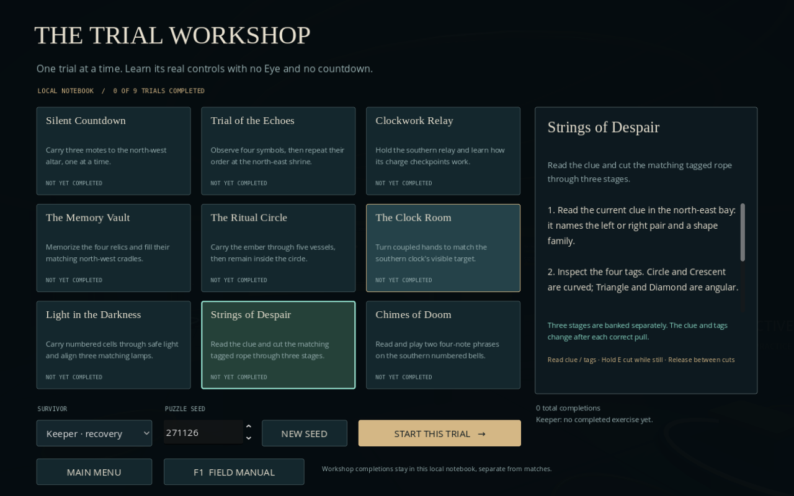
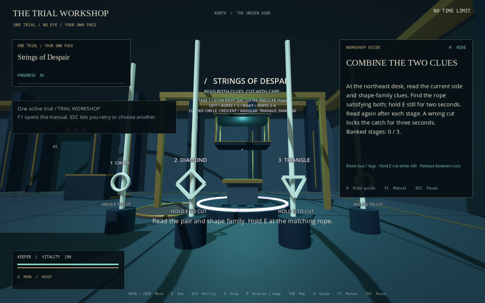
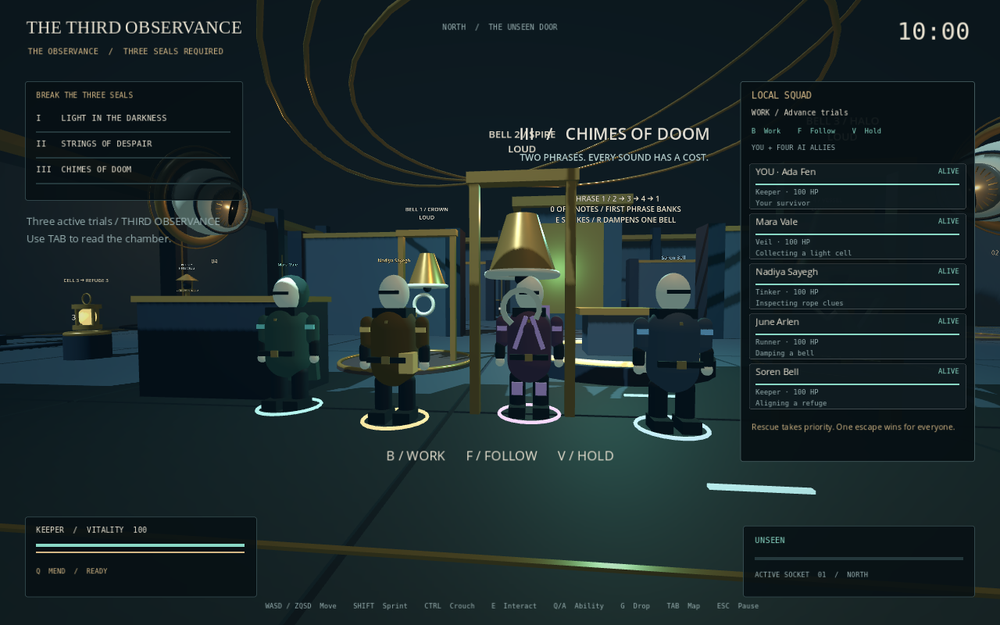

# THE EYES

### The Trial Workshop · local 3D prototype 0.5.0

**It cannot follow you. It only needs to see you.**

An original asymmetrical nightmare game by **Darknigthmare**. Break three seals
and escape a hostile observatory while an enormous, immobile Eye watches real
sightlines, commands traps, and summons stalking shadows. Lead four AI allies,
choose their priorities and rescue one another under pressure. **The Trial
Workshop** now lets you learn any of the nine implemented trials on its own,
with no Eye or countdown, then return to the complete observance.

This repository contains the playable **Godot prototype**, a detailed English
**game bible covering all 25 source trials**, and a **UE5 Blueprint-only
construction foundation**. The production target remains 5–7 survivors against
one Eye; the new five-survivor Squad is local, with one human and four AI allies.



## Start here

**[Windows x64 package — THE EYES 0.5.0](https://github.com/darknigthmare/THE_EYES/releases/download/v0.5.0/THE_EYES_v0.5.0_Windows_x64.zip)**
· [Release, checksums and startup report](https://github.com/darknigthmare/THE_EYES/releases/tag/v0.5.0)

Extract the entire ZIP and run **THE_EYES.exe**. Godot is not required for the
package. Publication requires native Windows headless startup for all
**21 scenarios: twelve mode × contract combinations and nine individual practice drills**. The release evidence
is `WINDOWS_SMOKE.json`; graphical Windows playthrough and hardware performance
remain separate checks. The package is an unsigned development build.

| I want to… | Open |
| --- | --- |
| Play | [English guide](docs/PLAY.md) · [Guide français](docs/DEMARRAGE_FR.md) |
| See what changed | [0.5.0 release notes](docs/releases/V0_5_0.md) |
| Understand the squad | [Squad and rescue](docs/bible/13_SQUAD_AND_RESCUE.md) |
| Learn the nine trials | [Trial Workshop](docs/bible/15_TRIAL_WORKSHOP.md) · [The Third Observance](docs/bible/14_THIRD_OBSERVANCE.md) |
| Read the complete design | [Bible index](docs/bible/README.md) · [25-trial catalogue](docs/bible/06_TRIAL_CATALOGUE.md) |
| Inspect the game | [Godot project](game/project.godot) · [Scene controller](game/scripts/main.gd) |
| Build the Unreal version | [UE5 foundation](unreal/README.md) · [Squad Blueprint recipe](docs/technical/SQUAD_IMPLEMENTATION.md) |
| Review evidence | [v0.5 verification](docs/qa/V0_5_VERIFICATION.md) · [Test guide](game/tests/README.md) |
| Compare with the brief | [Original supplied concept](docs/source/ORIGINAL_CONCEPT.txt) |

## Three local match modes and a workshop

| Menu entry | Your encounter | Recovery |
| --- | --- | --- |
| **Play Solo as a Survivor** | One human survivor against the AI Eye | First fall offers Second Sight |
| **Lead a Local Squad · You + 4 AI** | One human survivor and four AI allies against the AI Eye | One physical ally-assisted revival per member |
| **Take the Eye's Seat** | Human Eye against four AI survivors | Existing Eye-mode rules |
| **Trial Workshop** | One selected trial, one human survivor, no Eye or countdown | Same trial checkpoints; quick retry and separate notebook |

Begin with **Trial Workshop** to learn an individual objective, or choose
**Story / Keeper / First Observance** for a complete introductory match. The three
match modes support First, Second, Third and Seeded Mix. The workshop selects a
trial directly. There is no online lobby or second local human controller.

### Practise, understand and retry

Choose one of nine drills, a survivor archetype and a seed. Walk from the normal
spawn and complete the real objective using the same cargo, line-of-sight, reach,
hold, cooldown and checkpoint rules. Only its bay is active; the other two have
no tasks. There is no Eye AI, gaze damage, trap attack, deadline or escape.

The contextual guide explains the next action without revealing unseen puzzle
answers. **F1** opens the field manual during play and pauses the scene. Closing
it leaves the pause screen visible until you choose Resume. Losing application
focus also pauses; regaining focus never resumes automatically.

On completion, retry the same seed, try another seed, move to the next drill or
return to the catalogue. A bounded local notebook stores attempts, completions
and the best time **per trial and per archetype**, so Tinker’s machinery bonus
is not compared with another character. It is separate from competitive match
results and contains no mid-trial save. The stable `THE_EYES` user-data directory
holds this notebook and future settings.



### Lead, help, and survive

**B — Work** sends allies toward the active trials. **F — Follow** brings them
with you. Switching to **V — Hold** records each bot's own position. Immediate
self-preservation, a viable rescue, and open-exit evacuation can override these
ordinary orders. A bot evading a nearby visible shadow moves through real
geometry and resumes its legitimate task afterward.

A member's first lethal fall starts **35 seconds of bleedout**. Reach them,
stand still within **1.8 m** with clear sight, and **hold E for six continuous
seconds** before the timer expires. Moving, losing sight/range, releasing E, or
being hit interrupts the attempt and resets its progress. A rescue restores
**35 HP and five seconds of protection**. The next lethal fall eliminates that
member. If nobody remains active to help, the squad falls.

Keeper's Q ability heals the **most injured eligible active member, including
self**, for up to 30 HP. Allies must be within 4 m and clear sight; equal health
favors the Keeper. Its cooldown is 35 seconds. Healing does not revive a downed
member. If you are eliminated, **1–4 / mouse wheel** watches surviving allies.
The first valid escape still wins for the whole team.



## Nine trials, three seals

| Contract | Northwest | Northeast | South |
| --- | --- | --- | --- |
| **First Observance** | Silent Countdown | Trial of the Echoes | Clockwork Relay |
| **Second Observance** | The Memory Vault | The Ritual Circle | The Clock Room |
| **Third Observance** | Light in the Darkness | Strings of Despair | Chimes of Doom |
| **Seeded Mix** | Countdown, Vault or Light | Echoes, Ritual or Strings | Relay, Clock or Chimes |

Seeded Mix has **27 possible sets**. Version 0.4 expands its selection from two
to three choices per bay, so a seed from 0.3 may choose a different Mix layout. The seed repeats trial selection and puzzle
setup within the same game version; it does not guarantee identical AI or
physics timing. Each competitive round activates exactly three trials; Workshop activates one.

| Trial | Physical objective |
| --- | --- |
| Silent Countdown | Carry three distinct whisper motes to the northwest desk; sprinting with cargo makes noise. |
| Trial of the Echoes | Observe four symbols and repeat their seeded order; the Eye remains active in competitive matches. |
| Clockwork Relay | Hold the south wheel; banked thirds survive a retreat. Squad contributions combine once per frame, capped at 1.8× base. |
| The Memory Vault | Read four named targets, retrieve their real shapes from six shelves, and fill the exact indexed cradles. |
| The Ritual Circle | Carry the shared ember between five ordered vessels, then stay inside the ring for eight seconds; movement within it is allowed. |
| The Clock Room | Walk between coupled reversible levers, match three hands, and press the central seal. Generated starts require four optimal turns. |
| Light in the Darkness | Carry three uniquely owned cells to their matching lamps. Hold E still for two seconds; charge recovers at the base and lit refuges. |
| Strings of Despair | Read side and shape-family clues; hold E to cut one of four tagged ropes. Three cage stages bank; a wrong cut triggers a recoverable safety catch. |
| Chimes of Doom | Walk between four bells and ring two four-note phrases. E strikes; R moves the one shared damper. The first phrase stays banked after mistakes. |

Three completed seals open the north door and start a fresh escape countdown.
Hold E there for 1.5 seconds. Seals and accepted checkpoints remain permanent.

## Controls

Labels use physical QWERTY positions: movement is **ZQSD** on AZERTY and the
Q-labelled ability is **A**. Top-row 1–4 positions work without Shift.

| Input | Survivor action |
| --- | --- |
| WASD / ZQSD or arrows; mouse | Move; look |
| Shift; Ctrl/C; Space | Sprint; crouch; jump |
| E / hold E | Interact, charge, rescue, or escape as prompted |
| Q / AZERTY A; G | Archetype ability; release carried objective |
| B / F / V in Squad | Work / Follow / Hold |
| 1–4; R in Echoes | Repeat symbols; replay the observed sequence |
| E / R at Clock levers; X at centre | Forward / reverse; reset |
| E / R at a bell | Strike / toggle the one shared damper |
| 1–4 / wheel after Squad elimination | Watch another surviving ally |
| Tab; Escape | Map; pause/settings |
| F1 | Field manual; pauses active gameplay |

The Eye uses mouse aim, **1–4 / wheel** to change sockets, **left click** for a
visible trap, **right click** to mark, and **Q / AZERTY A** to summon. Geometry,
energy, cooldowns, and warnings constrain its actions.

## Run from source

Use standard **Godot 4.7.2**; .NET is unnecessary. Import `game/project.godot`,
wait for resources, then press **F5**.

```bash
godot --editor --path game --import
godot --path game
```

No API key, account, server, external asset pack, or plugin is required.
Procedural geometry, original synthesized sounds, and licensed fonts are included.

## Implemented and planned

| Area | Local prototype | Production direction |
| --- | --- | --- |
| World | One connected 54 × 48 m observatory and four fixed sockets | Four complete nightmare realms |
| Sessions | Solo, local Squad, human Eye; four contracts; nine individual practice drills | Networked 5–7 versus 1 play |
| Content | Nine trial subsets; four archetypes; existing eight character names used for squad identity | All 25 trials, final rigs, animation and narrative assets |
| Cooperation | Orders, physical rescue, Keeper support, roster and ally spectating | Expanded cooperative kits and online coordination |
| Persistence | Settings, schema-3 last-match ledger, separate schema-1 practice notebook with 9 × 4 records | Profile, reconnect and progression; no current mid-match save |
| Unreal | Project foundation, ten CSV tables and Blueprint recipes | Playable maps and compiled Blueprint assets |

The **16 other trials**, full production variants, networking, controller/input
remapping, complete realms and finished Unreal gameplay remain future work.
The Unreal directory contains construction material, not fabricated binary
Blueprint assets.

## Development and verification

The v0.5 verification report records the exact final test counts, complete
ordinary-input routes and platform results. Seventeen required suites cover
the existing competitive game and new practice authority, persistence, UI,
physical admission and transitions. Nine additional practice routes use the
same normal movement and interaction drivers as the competitive routes.

The competitive routes retain their active Story Eye. Their informed drivers
use ordinary movement and interaction; they do not inject actor positions,
health, clock changes or completed progress. These establish scoped completion,
not novice usability, all-difficulty balance or hardware frame rates. All 27
Mix mappings must still complete through physical bot routes.

The [v0.5 verification report](docs/qa/V0_5_VERIFICATION.md) distinguishes local
gameplay evidence, staged native screenshots and exact-build Windows startup
evidence. Earlier release evidence remains in its versioned reports.

Run the suites listed in [the test guide](game/tests/README.md). For example:

```bash
godot --headless --editor --path game --import
godot --headless --path game --script res://tests/test_squad_state.gd
godot --headless --path game --fixed-fps 60 --audio-driver Dummy --script res://tests/test_squad_route.gd
```

`tools/build_windows.py` exports with the matching template, validates the
executable/archive, and records checksums and provenance. The release workflow
requires all seventeen suites and the exact archive's twenty-one native Windows
startup cases before publication. See the report for completed gates and limitations.

## Credits

Project direction and source brief: **Darknigthmare**. Fiction, character
elaborations, procedural art and synthesized audio are original project material.
Engine and font attribution appears in
[THIRD_PARTY_NOTICES.md](THIRD_PARTY_NOTICES.md).
