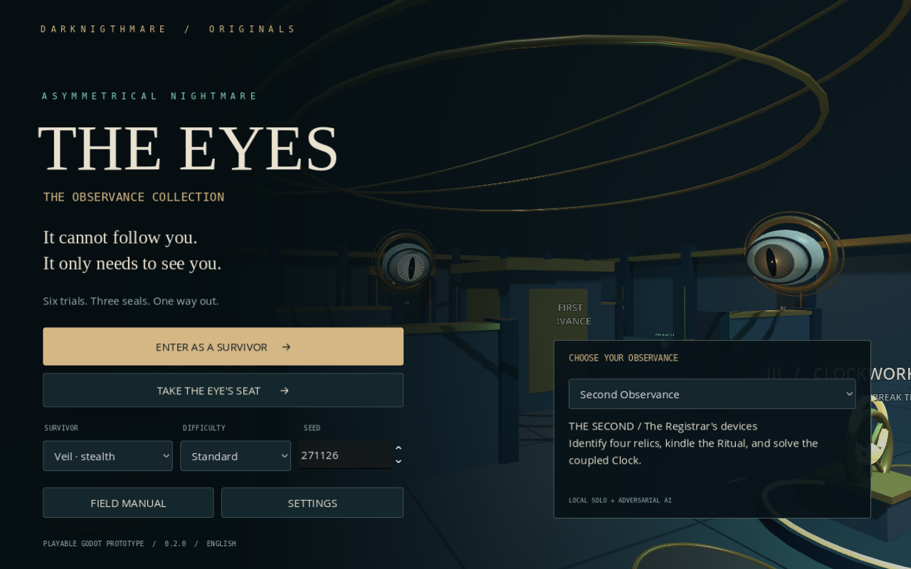
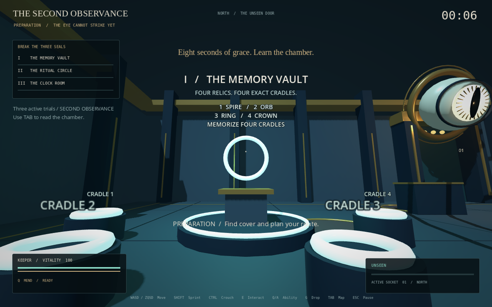

# THE EYES

### The Observance Collection · playable prototype 0.2.0

**It cannot follow you. It only needs to see you.**

An original asymmetrical nightmare game by **Darknigthmare**. Survivors break
three trial seals and escape a hostile observatory. A gigantic, immobile Eye
changes between authored sockets, watches real sightlines, commands traps and
calls stalking shadows. Architecture, time and influence limit its gaze.

This repository contains a **playable local 3D Godot game**, a detailed
**English game bible covering all 25 proposed trials**, and a **UE5 Blueprint-only
construction foundation**. The long-term target is 5–7 survivors against one
human or AI Eye. Today you can play a survivor against the AI Eye, or the Eye
against four physical AI survivors.



## Start here

**[Download THE EYES 0.2.0 for Windows x64](https://github.com/darknigthmare/THE_EYES/releases/download/v0.2.0/THE_EYES_v0.2.0_Windows_x64.zip)**
· [Release, checksums and Windows startup report](https://github.com/darknigthmare/THE_EYES/releases/tag/v0.2.0)

Extract the entire ZIP and run `THE_EYES.exe`. Godot is not required. This is an
unsigned development build. The release workflow gates publication on native
Windows headless startup in both roles under all three contracts; its exact
execution evidence is `WINDOWS_SMOKE.json`. A graphical Windows playthrough and
hardware performance qualification are separate remaining checks.

| I want to… | Open |
| --- | --- |
| Play | [Quick start](docs/PLAY.md) · [Guide français](docs/DEMARRAGE_FR.md) |
| See what changed | [0.2.0 release notes](docs/releases/V0_2_0.md) |
| Read the complete design | [Game bible index](docs/bible/README.md) |
| Explore the 25 challenges | [Trial catalogue](docs/bible/06_TRIAL_CATALOGUE.md) |
| Understand the six playable subsets | [Prototype contracts](docs/bible/12_PROTOTYPE_CONTRACTS.md) |
| Inspect the source | [Godot project](game/project.godot) · [Scene controller](game/scripts/main.gd) |
| Build the Unreal version | [UE5 foundation](unreal/README.md) · [Blueprint implementation](docs/technical/UE5_BLUEPRINT_IMPLEMENTATION.md) |
| Understand networking and saves | [Network and save contracts](docs/technical/NETWORK_AND_SAVE_CONTRACTS.md) |
| Produce final assets | [Art, animation and sound production](docs/technical/ASSET_PRODUCTION.md) |
| Review actual verification | [0.2.0 report](docs/qa/V0_2_VERIFICATION.md) · [Tests](game/tests/README.md) |
| Compare with the source brief | [Supplied concept](docs/source/ORIGINAL_CONCEPT.txt) |

## Six trials, three seals

Choose a **contract**, archetype, difficulty and seed before entering either role.
Each match activates exactly one trial in each of the observatory's three bays.

| Contract | Northwest | Northeast | South |
| --- | --- | --- | --- |
| **First Observance** | Silent Countdown | Trial of the Echoes | Clockwork Relay |
| **Second Observance** | The Memory Vault | The Ritual Circle | The Clock Room |
| **Seeded Mix** | Countdown or Vault | Echoes or Ritual | Relay or Clock |

Seeded Mix gives **eight possible sets**. The same seed and contract reproduce
the selected set and puzzle setup. Seeds do not guarantee identical match timing.

| Trial | What you actually do |
| --- | --- |
| Silent Countdown | Carry three distinct whisper motes to the northwest desk. Sprinting with a mote makes noise. |
| Trial of the Echoes | Observe a seeded four-symbol pattern and repeat it while the Eye remains active. |
| Clockwork Relay | Hold the south wheel, retreat when needed, and preserve banked thirds of progress. |
| **The Memory Vault** | Read four named relics, retrieve them from six southern shelves, and place each in its exact numbered cradle. |
| **The Ritual Circle** | Carry the shared ember between five ordered vessels. Bank each pair, then remain inside the ring for eight seconds; you may keep moving within it. |
| **The Clock Room** | Walk between three coupled levers, turn forward or backward, match all three hands, then confirm at the centre. Each generated start has a four-turn optimal solution. |

All three seals open the north door and start a separate escape countdown.
Hold E at the doorway to escape. The first survivor escape wins for the team;
elimination or an expired clock wins for the Eye. A solo survivor's first fall
leads to the **Second Sight** timing room. A failed recovery or subsequent fall
is final.



## Play from source

Tested with **Godot 4.7.2**, standard version; .NET is unnecessary.

1. Clone or download this repository.
2. Import `game/project.godot` and let Godot finish resource import.
3. Press **F5**.
4. Choose **Story / Keeper / First Observance** for an introductory survivor run,
   or **Second Observance** to try the new apparatus.

```bash
godot --editor --path game --import
godot --path game
```

No API key, account, server, external asset pack or plugin is required. Original
procedural geometry, sounds and the licensed fonts are included.

### Controls

Labels use physical QWERTY positions. On AZERTY, movement is **ZQSD** and the
Q-labelled ability uses **A**. Top-row 1–4 positions work without Shift.

| Survivor | Action |
| --- | --- |
| WASD / ZQSD or arrows; mouse | Move; look |
| Shift; Ctrl/C; Space | Sprint; crouch; jump |
| E / hold E | Interact / charge / escape |
| Q (A on AZERTY) | Archetype ability |
| G | Drop a mote or safely return a relic/ember |
| 1–4; R in Echoes | Enter symbols; replay the observed pattern |
| E / R near a Clock lever; X at the Clock centre | Forward / reverse; reset the Clock |
| Tab; Escape | Chamber map; pause/settings |

| The Eye | Action |
| --- | --- |
| Mouse; 1–4 / wheel | Rotate a fixed view; change socket |
| Left / right mouse | Trigger a visible trap / mark a visible survivor |
| Q (A on AZERTY) | Summon a shadow on visible, unoccupied ground |
| Tab; Escape | Map; pause/settings |

## Implemented and planned

| Area | Playable 0.2.0 | Full-game direction |
| --- | --- | --- |
| Engine | Godot 4.7.2, GDScript, Compatibility renderer | UE5, Blueprint-only project logic |
| Match | Survivor vs AI Eye; Eye vs four AI survivors | 5–7 human/AI survivors vs one Eye |
| World | Connected 54 × 48 m observatory, four sockets and physical cover | Four complete nightmare realms and modular arenas |
| Trials | Six playable subsets, three contracts, three active seals, one recovery room | All 25 source trials with expanded production variants |
| Survivors | Veil, Tinker, Runner, Keeper; Tinker can obtain temporary Clock advice | Eight original characters and expanded cooperative kits |
| Eye | Physics-ray occlusion, energy, cooldowns, marking, eight traps, two-shadow cap | Specializations and nightmare events |
| Interface | English HUD/manual/map/results; three difficulties; seeded contracts | Lobby, remapping, controller support, localization, progression |
| Art/audio | Original procedural geometry and synthesized nonverbal sounds | Production models, rigs, animation, textures and authored soundscape |
| Persistence | Local settings and versioned last-match JSON including selected trials | Profile, progression, reconnect and network persistence |
| Networking | Local only | Server-authoritative multiplayer design included |
| Unreal | Descriptor, configuration, seven CSV tables and detailed node recipes | Playable maps and compiled Blueprint assets |

The UE5 directory is a construction foundation with explicit editor steps. There
is no finished Unreal build or fabricated binary Blueprint asset. The remaining
**19 trial designs** and the multiplayer target have not been implemented.
Lumen/Nanite budgets are production targets, not measured Godot achievements.

## Development and verification

Import once, then run the six production-engine suites documented in
[the test guide](game/tests/README.md). Representative commands:

```bash
godot --headless --editor --path game --import
godot --headless --path game --script res://tests/test_trial_set.gd
godot --headless --path game --fixed-fps 60 --audio-driver Dummy \
  --script res://tests/test_second_world.gd
godot --headless --path game --fixed-fps 60 --audio-driver Dummy \
  --script res://tests/test_second_survivor_route.gd
```

Verification includes **72 cases / 2,420 assertions**, all eight Mix bot routes,
and complete First and Second survivor routes against the active Story Eye.
The input drivers use real movement and interaction; they know the map and are
not novice usability tests. Native-renderer captures are included separately.

`tools/generate_audio.py` reproduces the WAV palette. `tools/build_windows.py`
exports the source version with an official matching template, embeds the game,
checks the executable/archive, and records build metadata and checksums.
The release workflow tests the exact exported ZIP on a Windows runner before
publishing it. See the report for the scope and limits of each check.

## Credits

Project direction and source brief: **Darknigthmare**. Fiction, character
elaborations, procedural art and synthesized audio are original project material.
No branded characters, copied arenas or sampled media are included. Engine and
font attribution appears in [THIRD_PARTY_NOTICES.md](THIRD_PARTY_NOTICES.md).
